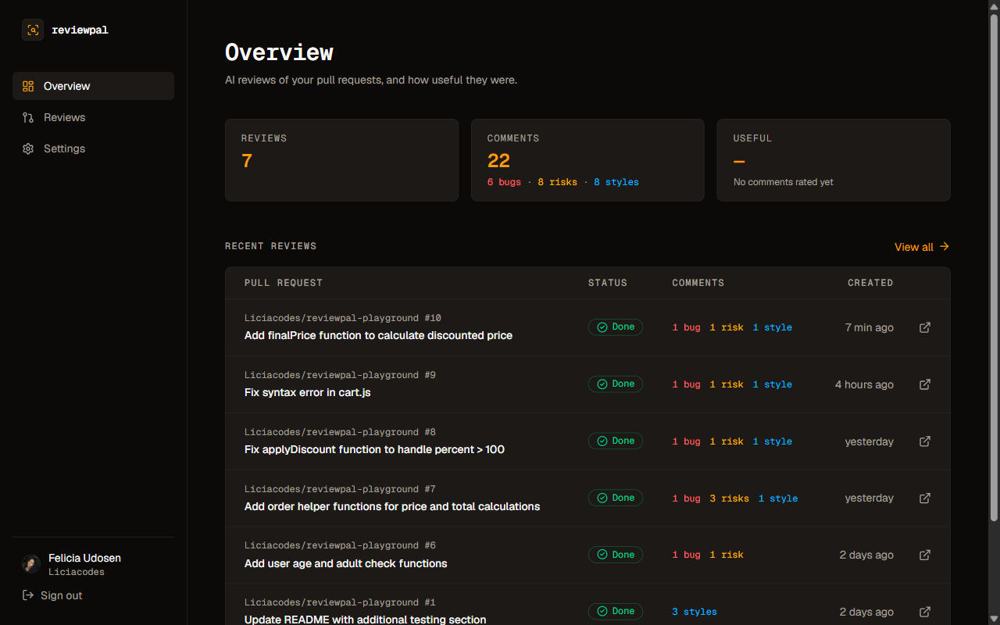
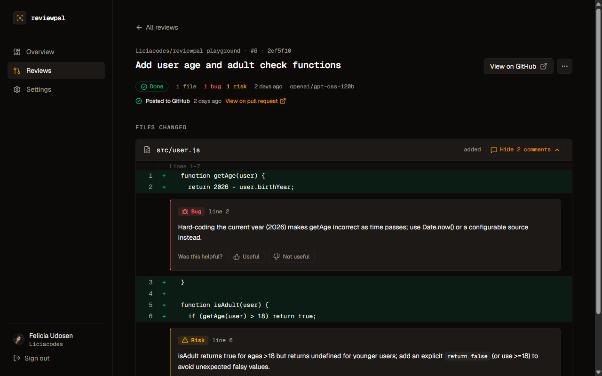
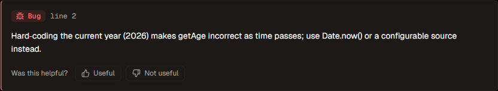
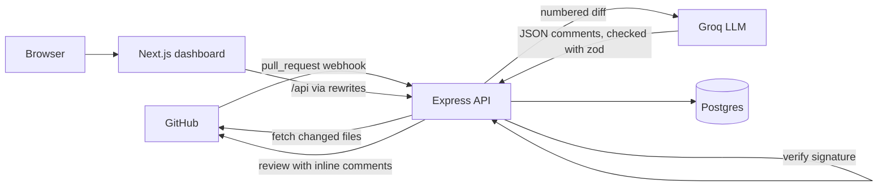

# ReviewPal

An AI code reviewer for GitHub pull requests.

When a pull request is opened or updated, ReviewPal reads the diff, asks an LLM for review
comments, and posts them on the pull request as inline comments. A dashboard shows every review
and lets you rate each comment as useful or not.

**Live dashboard:** https://reviewpal.vercel.app. Click **View demo** to explore a sample repository without signing in (read-only).<br>
**Example review on GitHub:** [reviewpal-playground#6](https://github.com/Liciacodes/reviewpal-playground/pull/6)

## Demo

https://github.com/user-attachments/assets/54d3807c-71ec-4858-a1b5-19d7cbe815d4

## Screenshots

**Overview:** stats and recent reviews



**Review detail:** the diff with the AI comments placed under the lines they refer to



**A comment:** severity, the line it refers to, and a usefulness rating



## Why I built it

I use AI tools every day, and I wanted to understand what actually happens behind them, not just use them. So I built ReviewPal to learn how a real tool connects to GitHub, keeps webhooks secure, and makes AI output reliable enough to trust. It also gave me a reviewer for my own pull requests.

## How it works

1. **Webhook:** GitHub sends a `pull_request` event when a PR is opened or updated.
2. **Signature check:** the server verifies the HMAC-SHA256 signature over the raw request body
   and rejects anything that doesn't match.
3. **Fetch the diff:** it gets the changed files through the GitHub App's installation token.
4. **Numbered diff to the AI:** every line on the new side is prefixed with its line number, so
   the model can say exactly which line a comment is about.
5. **Validation:** the model must answer in JSON. The answer is checked with a zod schema before
   anything is saved.
6. **Save:** the review, files and comments are stored in Postgres.
7. **Post on GitHub:** one pull request review with inline comments. Comments on lines outside
   the diff are listed in the review text instead, so nothing is lost.
8. **Dashboard:** signed-in users see the reviews for their repositories and rate the comments.



## Features

- **Inline comments with severity:** each comment is a bug, a risk or a style issue, placed on the exact line.
- **No duplicate reviews:** each commit is reviewed once, even if GitHub redelivers the webhook,
  and a review is never posted to GitHub twice.
- **Fair diff budget:** lock files, generated files and binaries are skipped, and the remaining
  files share the size limit fairly. Skipped or shortened files are listed in the review.
- **Retries and re-run:** a temporary AI failure (rate limit, server error, network error, invalid
  JSON) is retried once. Any review can be run again from the dashboard.
- **Stuck-review timeout:** a review still pending after 10 minutes, for example because the server
  restarted, is marked failed so it can be re-run.
- **GitHub sign-in with per-user access:** users only see reviews for repositories where the app is
  installed and they have access. Everything else returns 404.
- **Usefulness ratings:** each comment can be rated useful or not useful. The overview shows the share of useful comments.
- **Read-only demo:** visitors can explore one sample repository without signing in. The demo can't see
  any other repository, and the server refuses every write from a demo visitor (a test checks every write route).

## Tech stack

| Layer | Tools |
|---|---|
| API and webhooks | Node.js 22, Express 5, TypeScript, Octokit (GitHub App) |
| Dashboard | Next.js 16 (App Router), React 19, Tailwind CSS 4, lucide-react |
| Database | PostgreSQL on Neon, Prisma 7 |
| AI | Groq (`openai/gpt-oss-120b`), zod for validating the output |
| Hosting | Render (API), Vercel (dashboard) |
| Tests | Vitest (server and dashboard) |

## Engineering decisions

- **The signature is checked over the raw bytes.** GitHub signs the exact body it sends, so the
  webhook route uses `express.raw`. Parsing the JSON first and re-serialising it would change the
  bytes and break the check. The comparison uses `crypto.timingSafeEqual`, so response timing
  doesn't leak how much of a forged signature was correct.
- **Line numbers are given to the model, not left for it to count.** Models are unreliable at
  counting lines from `@@` diff headers, and a wrong number puts the comment on the wrong line
  (or GitHub rejects it). Prefixing each line with its number turns counting into copying.
- **AI output is never trusted.** The answer must be valid JSON that matches a zod schema; if not,
  it is retried once and then the review fails visibly. Before posting, every comment's line is
  checked against the lines that actually appear in the diff.
- **The browser only talks to the dashboard's domain.** Next.js rewrites forward `/api` and `/auth`
  to the API. The session cookie is then first-party (httpOnly, SameSite=Lax), so it isn't affected by
  third-party cookie blocking, and no CORS is needed. The cost is one extra network hop. Changes
  also need a CSRF token.
- **The free hosting tier sleeps, and webhooks don't wait.** To stay within the free tier's
  monthly hours, the server is allowed to sleep. When a webhook arrives, it wakes the server,
  and on startup the server asks GitHub to redeliver any recent webhooks that failed, so the
  review still happens about a minute later.
- **Secrets stay secret.** GitHub user tokens are encrypted at rest (AES-256-GCM), sessions are
  stored as hashes, and logs contain error messages only, never tokens or request details.

## Running locally

You need Node.js 22, a PostgreSQL database (a free Neon project works), a Groq API key, and your
own GitHub App. The app needs **Pull requests: Read and write** permission, a subscription to
**Pull request** events, and a webhook URL pointing at your machine through a tunnel such as
[smee.io](https://smee.io).

```bash
git clone https://github.com/Liciacodes/reviewpal.git
cd reviewpal
npm install                      # also generates the Prisma client
cp .env.example .env             # then fill in the values
npm run db:migrate               # create the tables
npm run dev                      # API on http://localhost:3000

cd web
npm install
npm run dev                      # dashboard on http://localhost:3001
```

Environment variables (names only; see `.env.example`):

| Variable | Purpose |
|---|---|
| `DATABASE_URL`, `DIRECT_URL` | Postgres: pooled URL for the app, direct URL for migrations |
| `GITHUB_APP_ID`, `WEBHOOK_SECRET` | GitHub App identity and webhook signature secret |
| `GITHUB_PRIVATE_KEY_PATH` or `GITHUB_PRIVATE_KEY` | The GitHub App private key (file path or value) |
| `GITHUB_CLIENT_ID`, `GITHUB_CLIENT_SECRET` | The GitHub App's OAuth credentials, for sign-in |
| `TOKEN_ENCRYPTION_KEY` | 32 random bytes (base64), for encrypting GitHub user tokens |
| `GROQ_API_KEY`, `GROQ_MODEL` (optional) | The LLM |
| `DASHBOARD_URL` | Dashboard address, used for the sign-in callback |
| `DEMO_REPO` (optional) | The public repo shown in the read-only demo, e.g. `Liciacodes/reviewpal-playground` |
| `API_ORIGIN` (dashboard, optional) | Where the dashboard forwards API calls (default `http://localhost:3000`) |
| `PUBLIC_SIGNIN` (dashboard, optional) | `true` makes "Sign in with GitHub" the main button; default: "View demo" is |

If anything required is missing, the server refuses to start and lists the missing names.
For production on Render and Vercel, see **[DEPLOY.md](DEPLOY.md)**.

## Tests

```bash
npm test            # server tests
npm run test:all    # server + dashboard tests
```

The tests cover the logic that is easy to get wrong:
- diff parsing and line numbering, skipped files and the size budget
- splitting comments between inline and the review text
- retry decisions and the stuck-review rule
- access control, the read-only demo and session crypto
- startup config checks and webhook redelivery

They don't need a database, network access or API keys.

## What's next

- **Public install with usage limits:** let anyone install ReviewPal, with per-installation limits on AI usage.
- **Learning from ratings:** use the useful / not useful ratings to tune the prompt and drop the kinds of comments people don't find helpful.
- **Background job queue:** move reviews out of the web process into a queue with retries, so restarts and slow reviews don't affect each other.
- **Separate production database:** a Neon branch for production, so local testing never touches live data.
